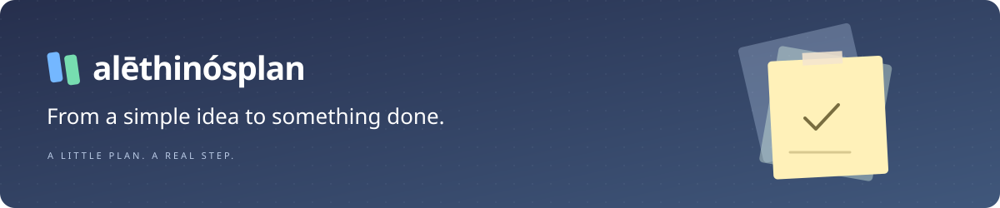
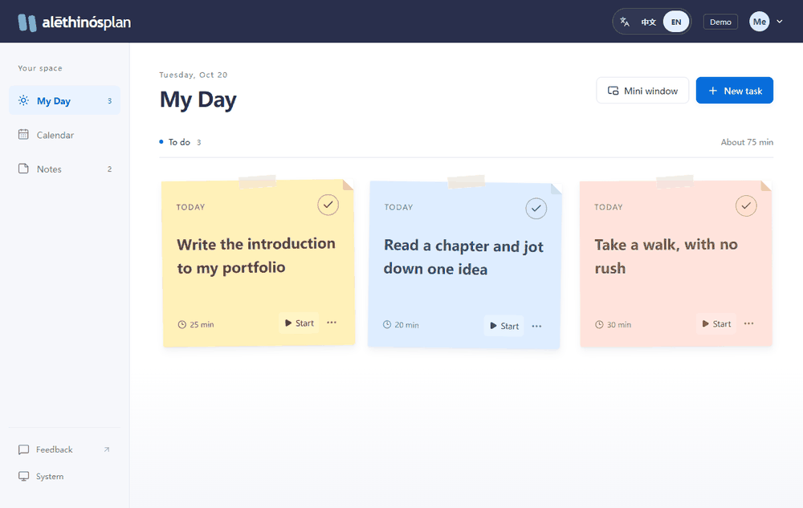
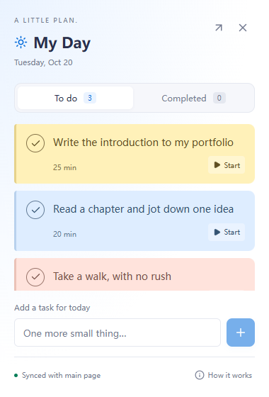
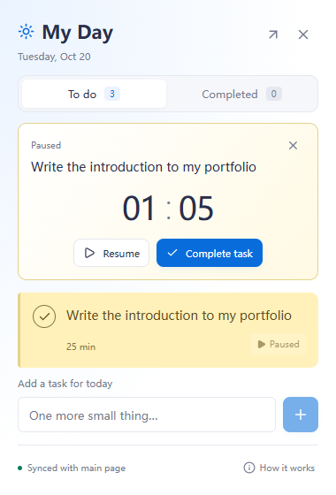

<p align="center"><a href="README.md">简体中文</a> · <strong>English</strong></p>

<p align="center">
  
</p>

<p align="center">
  <strong>You don't need to fill every day. Start with one thing that matters.</strong><br />
  A personal planning app that brings quick notes, scheduling, and focused work together.
</p>

<p align="center">
  <a href="https://alethinosplan.pages.dev/">Open the app</a> ·
  <a href="#features">Features</a> ·
  <a href="#quick-start">Quick start</a> ·
  <a href="docs/cloudflare-pages.md">Self-hosting guide (中文)</a> ·
  <a href="https://github.com/untiLJing-git/alethinosplan/issues/new/choose">Share feedback</a>
</p>

<p align="center">
  
  
  
  
  
  <a href="LICENSE"></a>
</p>

---

## See it in action



<p align="center"><sub>Recorded in English with local sample data, with no real accounts or private tasks. <a href="docs/assets/overview.en.png">View a still image</a></sub></p>

## Features

| Start here | What you can do |
| --- | --- |
| **My Day** | Plan your day with colorful sticky notes. Tear one off when you're done, or undo to bring it back. |
| **Calendar** | Organize plans in month and week views. Reschedule by editing a date or dragging a task on desktop. |
| **Notes** | Capture an idea without choosing a date. Add it to your calendar when you're ready. |
| **Focus on one thing** | Start a timer from a task, pause and resume, then return to your plans when you're done. |
| **Mini window** | In supported desktop browsers, keep your tasks on top. Add tasks, run a timer, switch between to-do and completed items, and undo across windows. |
| **Your own pace** | Choose light, dark, or system appearance. Use responsive mobile layouts and reduced-motion support. Save your personal plans with an email account. |
| **Two languages** | Switch between Simplified Chinese and English without reloading. Dates, controls, notifications, and the mini window follow your selection. |

## Choose your language

Use the **中文 / EN** switch in the top-right corner, next to the account menu. The sign-in page has the same control above the form, including on mobile.

- The app starts in Simplified Chinese and remembers your explicit choice in this browser.
- Switching languages preserves your current view, form input, and running timer. Open tabs and the mini window stay in sync.
- Your task titles and notes stay exactly as you wrote them. A fresh local demo uses the language selected when its sample data is first created; existing demo content is never rewritten.
- If browser storage is unavailable, the language still changes for the current session, with a notice that the preference couldn't be saved.

See the bilingual [localization guide](docs/i18n.md) for translation conventions and tests. Browser-native date pickers and validation prompts may follow your browser or operating system language. Authentication emails are configured separately in Supabase.

## Keep today within reach

<p align="center"> </p>

Select **Mini window** in My Day to keep your tasks nearby without returning to the full board. It shares task and timer state with the main page: start, pause, or resume in either window. Closing the mini window does not discard the current timer.

> The mini window requires a desktop browser with Document Picture-in-Picture support. It is not a standalone desktop app: it closes when you close the main page or sign out, and does not provide launch-at-startup, a system tray, or a fixed screen position. Its entry point is hidden on mobile. [Compatibility and limitations (中文) →](docs/desktop-window.md)

## Quick start

Live app: [alethinosplan.pages.dev](https://alethinosplan.pages.dev/). Sign up with your email address, verify it, and sign in. The live site does not offer an account-free demo.

To try the app locally, use Node.js 24.12.0, clone the repository, and run:

```sh
git clone https://github.com/untiLJing-git/alethinosplan.git
cd alethinosplan
npm ci
npm run dev
```

Open `http://127.0.0.1:5173/?demo=1` to explore local sample data without configuring Supabase. To start with English sample tasks, first open `http://127.0.0.1:5173/`, select **EN**, and then open the demo URL. Demo data stays in this browser and is never written to a real account. The demo entry point is disabled in production builds.

To connect your own account service, copy [.env.example](.env.example) to `.env.local` and set the Supabase project URL and **publishable key**. Configure authentication and the database using the [development and self-hosting guide (中文)](docs/development.md) and the [database README](supabase/README.en.md).

## Development and deployment

```sh
npm run check         # TypeScript checks
npm test              # Task rules, localization, and deployment configuration
npm run test:e2e      # UI, authentication, language switching, and mini-window regression tests
npm run build:pages   # Validate environment variables and build production assets
npm run test:pages    # Verify local Cloudflare Pages hosting
```

| Topic | Documentation |
| --- | --- |
| Local development, account configuration, and demo recording | [Development guide (中文)](docs/development.md) |
| Pages builds, environment variables, and auth redirects | [Deployment guide (中文)](docs/cloudflare-pages.md) |
| Mini-window features, compatibility, and limitations | [Mini-window guide (中文)](docs/desktop-window.md) |
| Appearance preferences and mini-window context menus | [Themes and menus (中文)](docs/theme.md) |
| Language preferences, translation conventions, and coverage | [Localization guide (中文 / English)](docs/i18n.md) |
| Feedback entry points and public issue submissions | [Feedback guide (中文)](docs/feedback.md) |
| Data structure and per-user isolation | [Database README](supabase/README.en.md) · [SQL schema](supabase/schema.sql) |

## Data and limitations

- Real account data is stored through Supabase. The versioned SQL defines the schema and row-level security policies; it contains no user data.
- Never commit server-side keys, database passwords, or backups. Values prefixed with `VITE_` are included in the frontend build and must contain only public client configuration.
- Cloud sync requires a network connection. The app is not fully offline-capable, and always-on-top windows are not supported by every browser.
- Before self-hosting, verify real email delivery, authentication redirects, and isolation between accounts. Automated tests are not a production security audit.

## Feedback and license

On desktop, **Feedback** is at the bottom of the sidebar. On mobile, it is in the account menu; the sign-in page also has a footer link. You can also [submit feedback directly](https://github.com/untiLJing-git/alethinosplan/issues/new/choose) or [check existing issues](https://github.com/untiLJing-git/alethinosplan/issues) first. Include reproduction steps, your browser, and device. Please do not share passwords, access tokens, or private task content.

The project is licensed under the [Apache License 2.0](LICENSE).

<p align="center"><sub>A little plan. A real step.</sub></p>
