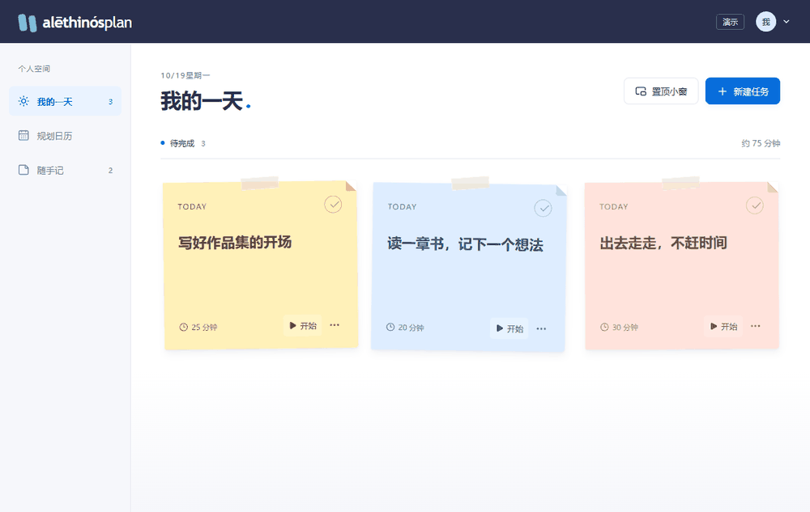
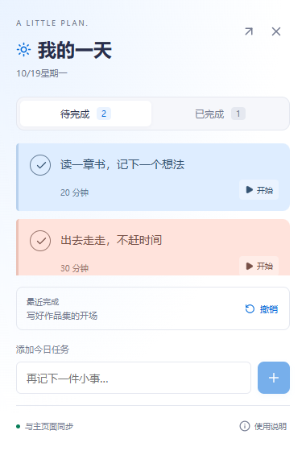
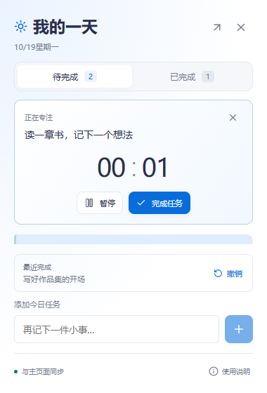

<p align="center">
  
</p>

<p align="center">
  <strong>不必填满每一天，先完成一件在意的小事。</strong><br />
  一个把随手记录、日程安排与专注执行连起来的个人计划应用。
</p>

<p align="center">
  <a href="https://alethinosplan.pages.dev/">打开应用</a> ·
  <a href="#功能一览">功能一览</a> ·
  <a href="#快速开始">快速开始</a> ·
  <a href="docs/cloudflare-pages.md">自行部署</a> ·
  <a href="https://github.com/untiLJing-git/realplan/issues/new/choose">提交反馈</a>
</p>

<p align="center"><sub>React · TypeScript · Vite · Supabase · Cloudflare Pages · Apache-2.0</sub></p>

---

## 看它如何工作



<p align="center"><sub>使用本地示例数据录制，不含真实账号或用户任务。<a href="docs/assets/overview.png">查看静态截图</a></sub></p>

## 功能一览

| 从这里开始 | 可以做什么 |
| --- | --- |
| **我的一天** | 用彩色便利贴安排今日任务；完成时撕下便签，也能撤销恢复。 |
| **规划日历** | 在月／周视图中安排计划，通过日期编辑或桌面拖动调整日程。 |
| **随手记** | 先捕捉念头，不急着定日期；想清楚后再安排到日历。 |
| **专注一件事** | 从任务进入计时，暂停、继续，或完成后返回计划。 |
| **置顶小窗** | 在支持的桌面浏览器中，切换待完成／已完成，直接新增、计时、完成、恢复和跨窗口撤销。 |
| **自己的节奏** | 支持浅色／深色／跟随系统、移动端布局与减少动态效果；邮箱账号保存个人计划。 |

## 把今天留在手边

<p align="center"> </p>

在「我的一天」点击 **置顶小窗**，不必反复切回整个任务看板。小窗和主页面共用任务与计时状态：开始、暂停、继续不用切回主页面，关闭小窗也不会丢失当前计时。

> 小窗依赖桌面浏览器的 Document Picture-in-Picture 支持。它不是独立桌面程序：关闭主页面或退出账号后会关闭，也不提供开机自启、系统托盘或固定屏幕坐标。手机端不显示此入口。[查看支持范围与使用说明 →](docs/desktop-window.md)

## 快速开始

正式站点：[alethinosplan.pages.dev](https://alethinosplan.pages.dev/)。使用邮箱注册、验证后登录；线上版本不开放免注册演示入口。

想先在本地看看效果？使用 Node.js 24.12.0，克隆项目后运行：

```sh
git clone https://github.com/untiLJing-git/realplan.git
cd realplan
npm ci
npm run dev
```

打开 `http://127.0.0.1:5173/?demo=1` 即可体验本地示例，无需配置 Supabase。演示数据只保存在当前浏览器，不会写入真实账号；生产构建禁用此入口。

连接自己的账号服务时，将 [.env.example](.env.example) 复制为 `.env.local`，填写 Supabase 项目地址与 **publishable key**，然后按 [开发与自托管指南](docs/development.md) 配置认证和数据库。

## 开发与部署

```sh
npm run check         # TypeScript 检查
npm test              # 任务规则与部署配置测试
npm run test:e2e      # 页面交互、认证与小窗回归
npm run build:pages   # 检查环境并构建生产文件
npm run test:pages    # Pages 本地托管验收
```

| 想了解什么 | 从这里阅读 |
| --- | --- |
| 本地开发、账号配置、演示素材录制 | [开发指南](docs/development.md) |
| Pages 构建、环境变量、认证回跳 | [部署指南](docs/cloudflare-pages.md) |
| 小窗能力、兼容性与限制 | [小窗说明](docs/desktop-window.md) |
| 外观偏好、小窗右键操作 | [主题与菜单](docs/theme.md) |
| 反馈入口与公开提交说明 | [反馈说明](docs/feedback.md) |
| 数据结构与用户隔离 | [数据库说明](supabase/README.md) · [SQL 定义](supabase/schema.sql) |

## 数据与边界

- 正式账号的计划通过 Supabase 保存；仓库中的 SQL 只定义结构与 RLS 策略，不包含用户数据。
- 不要将服务端密钥、数据库密码或数据备份提交到仓库；`VITE_*` 会进入前端构建，只能放公开客户端配置。
- 云端同步需要网络；当前不是完整的离线应用，也不承诺所有浏览器都支持桌面置顶。
- 自行部署前，请验证真实邮件投递、认证回跳和账号间数据隔离。自动化测试不等于生产安全审计。

## 反馈与许可

桌面端可从左侧栏底部「反馈与建议」进入；移动端位于账号菜单，登录页底部也有入口。也可直接 [提交反馈](https://github.com/untiLJing-git/realplan/issues/new/choose)，选择问题反馈或功能建议；提交前可先 [查看已有 Issues](https://github.com/untiLJing-git/realplan/issues)。描述复现步骤、浏览器与设备即可，请勿附带密码、访问令牌或私人任务内容。

项目代码采用 [Apache License 2.0](LICENSE)。

<p align="center"><sub>A little plan. A real step.</sub></p>
